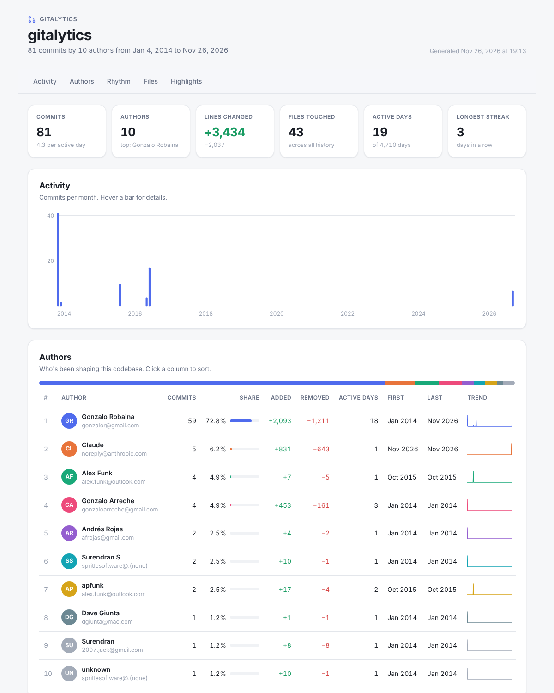

# Gitalytics

Commit statistics for any git repository, in your terminal or as a single self-contained HTML report.

Originally based on a gist by Tobin Harris: https://gist.github.com/tobinharris/396634

## Installation

Gitalytics needs Ruby 3.1 or newer and has no other runtime dependencies.

    gem install gitalytics

Or add it to your Gemfile:

    gem 'gitalytics'

## Usage

Run it from inside any git repository:

    $ gitalytics

This prints a summary of the repository: the period covered, totals for lines, files and active days, and a table of the top authors with their share of commits:

    gitalytics  83 commits by 10 authors
    Jan 6, 2014 to Nov 26, 2026 (4,708 days)

      Lines          +4,056 -2,258    Longest streak  3 days
      Files touched  44               Busiest day     Nov 26, 2026 (14 commits)
      Active days    18 of 4,708      Commits/day     4.6

      Author           Commits  Share               Added  Deleted  Last commit
      Gonzalo Robaina       57  68.7%  ██████▉     +2,045   -1,163  2026-11-26
      Claude                 9  10.8%  █▏          +1,501     -912  2026-11-26
      Alex Funk              4   4.8%  ▌               +7       -5  2015-10-17
      ... and 7 more authors (use --top 0 to list everyone)

The table fits your terminal width and uses colors in a terminal. Set `NO_COLOR` or pass `--no-color` to turn colors off, and use `--top N` to list more or fewer authors.

For the full HTML report, run:

    $ gitalytics -h

This writes `gitalytics_result.html` in the current directory and opens it in your browser. To write the report without opening it:

    $ gitalytics -n

The report is a single HTML file with no external CSS or JavaScript, so you can open it offline, attach it or publish it anywhere. It includes:

- an overview of commits, authors, lines changed, files touched, active days and the longest streak
- an activity timeline (per week, or per month for long histories)
- a sortable author leaderboard with each author's share and trend
- a weekday by hour punch card
- the most changed files and top directories
- highlights such as the first commit, the busiest day and the longest commit message

It follows your system's light or dark theme. Author avatars come from Gravatar when available and fall back to initials.

To look at a time window, or to feed the numbers into another tool:

    $ gitalytics -h --since "1 year ago"
    $ gitalytics --json --since 2024-01-01 --until 2024-12-31 > stats.json

### Options

| Option | Description |
| --- | --- |
| `-h`, `--html` | Write the HTML report and open it in your browser |
| `-n`, `--no-browser` | Write the HTML report without opening it |
| `-o`, `--output FILE` | Where to write the HTML report (default `gitalytics_result.html`) |
| `-j`, `--json` | Print a JSON summary (totals, authors, weekdays, top files) to stdout |
| `-s`, `--since DATE` | Only count commits after `DATE` (anything git accepts, e.g. `2024-01-01` or `"6 months ago"`) |
| `-u`, `--until DATE` | Only count commits before `DATE` |
| `-m`, `--no-merges` | Leave merge commits out of the stats |
| `-t`, `--top N` | How many authors the terminal summary lists (default 10, `0` for all) |
| `--[no-]color` | Force or disable colors in the terminal summary |
| `-e`, `--group-email` | Group commits by author email instead of name (case-insensitive) |
| `-b`, `--benchmark` | Print how long the analysis took |
| `-v`, `--version` | Print the version |

Authors are read through git's [`.mailmap`](https://git-scm.com/docs/gitmailmap), so add one to the repository to merge the identities of people who committed under several names or emails.

## Development

    bundle install
    bundle exec rake test
    bundle exec rubocop

## License
Copyright (c) 2016 Gonzalo Robaina

Permission is hereby granted, free of charge, to any person obtaining a copy
of this software and associated documentation files (the "Software"), to deal
in the Software without restriction, including without limitation the rights
to use, copy, modify, merge, publish, distribute, sublicense, and/or sell
copies of the Software, and to permit persons to whom the Software is
furnished to do so, subject to the following conditions:

The above copyright notice and this permission notice shall be included in
all copies or substantial portions of the Software.

THE SOFTWARE IS PROVIDED "AS IS", WITHOUT WARRANTY OF ANY KIND, EXPRESS OR
IMPLIED, INCLUDING BUT NOT LIMITED TO THE WARRANTIES OF MERCHANTABILITY,
FITNESS FOR A PARTICULAR PURPOSE AND NONINFRINGEMENT. IN NO EVENT SHALL THE
AUTHORS OR COPYRIGHT HOLDERS BE LIABLE FOR ANY CLAIM, DAMAGES OR OTHER
LIABILITY, WHETHER IN AN ACTION OF CONTRACT, TORT OR OTHERWISE, ARISING FROM,
OUT OF OR IN CONNECTION WITH THE SOFTWARE OR THE USE OR OTHER DEALINGS IN
THE SOFTWARE.
